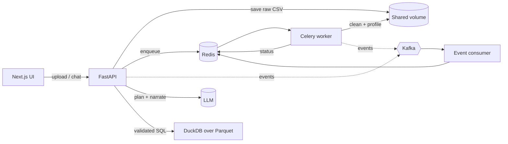

# CSV Analyst — chat with multiple CSV files

Upload several related CSV files, then ask questions in plain English. The system answers with
**text, charts, or both**, can **join across files**, and supports **follow-up questions**
("now break it down by category").

> Next.js (React) frontend · FastAPI backend · DuckDB analytics engine · Redis · Celery worker · Kafka events · Docker

---

## 1. Problem statement

Business users have data spread over many CSVs (orders, customers, products, payments …) and no SQL skills.
They want to ask *"What is the revenue by category over the last 6 months?"* and get a trustworthy answer
and a chart, without writing queries or merging files by hand.

Requirements from the assignment and where they are met:

| Requirement | How it is met |
|---|---|
| Upload multiple CSVs at once | `POST /datasets` takes `files[]`; the UI has a multi-file dropzone |
| Questions that span files | Every file becomes a table; foreign keys are auto-detected and given to the LLM, so it writes JOINs |
| Natural-language answers | A second LLM pass explains the *actual* result rows (it never sees data it didn't get) |
| Charts when useful | Planner picks `bar / line / area / pie / scatter`; backend reshapes data; one React component renders any chart |
| Data cleaning | Header normalisation, null tokens, type inference, dedupe, empty row/column removal, outlier **reporting** |
| Large files (optional) | CSV → Parquet via DuckDB (streaming, spills to disk), queries run on Parquet, async ingestion workers |
| Frontend + backend | Next.js 14 ↔ FastAPI over HTTP |
| Multi-turn (bonus) | Conversation history in Redis; the previous SQL is replayed to the model so follow-ups *edit* it |
| Dockerfiles (bonus) | Both images + a compose file with Redis, Kafka, worker, scheduler and consumer |

---

## 2. How it works



### Ingestion (asynchronous)
1. **Upload** – files are streamed to disk with a size limit (never fully in memory). The API replies `202`
   immediately with a dataset id; the UI polls `GET /datasets/{id}` and shows per-file progress.
2. **Clean** (`domain/ingestion/cleaner.py`, one DuckDB SQL pass each):
   - snake_case + de-duplicated column names; encoding detection (UTF‑8 / UTF‑16 / Latin‑1)
   - trim whitespace; `""`, `null`, `N/A`, `-` … → `NULL` (configurable)
   - **type inference** by match ratio (≥ 95 %): `BIGINT`, `DOUBLE` (handles `$1,200.50`), `BOOLEAN`, `DATE`, `TIMESTAMP`.
     Leading zeros (zip codes) keep the column as text. Values that fail the cast become `NULL` and are *counted*.
   - drop fully-empty rows/columns, drop exact duplicate rows
   - write ZSTD **Parquet** atomically (tmp file + rename → safe to retry)
3. **Profile** (`profiler.py`): per-column null %, distinct, min/max/mean/quantiles, **IQR outlier count**
   (reported, never silently removed), and the exact values of low-cardinality columns.
4. **Relationships** (`relationships.py`): a column with the same name as another table's primary key becomes a
   foreign key; it is kept only if ≥ 50 % of its distinct values exist in the parent (`match_rate`).

### Question answering (`domain/analysis/analyst.py`)
1. **Plan** – the LLM gets the schema (tables, types, ranges, category values, relationships) + recent turns and returns JSON:
   `{needs_query, sql, chart, assumptions, direct_answer}`.
2. **Guard** – `sql_guard.py` parses the SQL with **sqlglot** and enforces: one SELECT only, no DDL/DML, only known
   tables/CTEs, no file/introspection functions (`read_csv`, `glob`, `duckdb_*` …).
3. **Execute** – DuckDB runs it on views over the Parquet files with a timeout, row cap, memory limit and a
   concurrency semaphore. Results are cached in Redis (dataset + SQL hash).
4. **Self-repair** – if the SQL is rejected/fails (e.g. hallucinated column) the error is fed back to the model
   (up to `LLM_MAX_SQL_RETRIES`).
5. **Chart** – `chart_builder.py` validates the requested chart against the real result, pivots long→wide for series,
   caps series/categories/points, detects time axes, and falls back to an inferred chart if the request was unusable.
6. **Narrate** – a second LLM call explains the result rows only. If it fails, the user still gets the table and chart.

Relative dates ("last 6 months") are anchored to the **latest date in the data**, not today's date. The data in the
sample set ends on 2024‑11‑04, so "last 6 months" means May–Nov 2024. The answer states the concrete range.

### Why these infrastructure pieces
| Piece | Role | Why |
|---|---|---|
| **Celery + Redis** | Ingestion jobs, hourly cleanup (beat) | Cleaning a big CSV must not block HTTP workers; retry-safe, scalable by adding workers |
| **Redis** | Dataset metadata, conversations, query cache, rate limits, stats | Shared by all API replicas → stateless API |
| **Kafka** | Event log: `dataset.uploaded/ready/failed`, `chat.answered/failed` | Work queue = things to *do*; Kafka = things that *happened*. A consumer builds usage stats (`GET /stats`); more consumers (audit, billing, analytics) can be added without touching the API. Optional: `KAFKA_ENABLED=false` runs without it |
| **DuckDB + Parquet** | Cleaning, profiling and querying | Columnar, vectorised, out-of-core: multi-GB files without loading them into pandas |

---

## 3. Run it

### Docker (recommended)
```bash
cp .env.example .env          # sets OLLAMA_BASE_URL (defaults to host.docker.internal:11434)
docker compose up --build
```
- UI: http://localhost:3000  · API docs (Swagger): http://localhost:8000/docs
- Click **"Try the sample online shop"** to load the 8 bundled CSVs (`sample_data/`), or upload your own.

Services: `frontend`, `api`, `worker`, `beat`, `event-consumer`, `redis`, `kafka`.
Without an API key everything works *except* answering questions (the UI/API tell you so).

### Local development
```bash
docker compose up -d redis                       # only Redis is required locally
cd backend && python -m venv .venv && source .venv/bin/activate
pip install -r requirements-dev.txt && cp .env.example .env   # configured for local Ollama
make dev-api        # terminal 1  (http://localhost:8000)
make dev-worker     # terminal 2  (processes uploads)
make dev-web        # terminal 3  (http://localhost:3000)
```
Tests / lint: `make test`, `make lint`.

### Try these questions (sample data)
- *What is the total revenue?* · *How many orders are there per payment status?*
- *Show revenue by product category* → bar chart (joins `order_items` → `products`)
- *Show me the number of orders per month over the last 6 months* → line chart
- *Now break it down by carrier* → follow-up that edits the previous query
- *What is the customers' average age?* → correctly says there is no such column

---

## 4. Project structure

```
backend/app
├── main.py                 app factory, lifespan, middleware, routers
├── container.py            composition root (all wiring in one place)
├── core/                   config (env), logging, exceptions, constants
├── api/                    deps, middleware, error handlers, v1/endpoints/*   ← HTTP only
├── schemas/                Pydantic models: dataset, chat, events
├── services/               dataset_service, ingestion_service, chat_service    ← use-cases
├── domain/
│   ├── ingestion/          cleaner, profiler, relationships
│   ├── analysis/           analyst, sql_guard, query_engine, query_runner, chart_builder
│   └── llm/                provider-agnostic client, Ollama adapter, prompts
├── repositories/           Redis persistence: datasets, conversations, query cache, stats
├── infrastructure/         redis client, file storage, Kafka publisher, rate limiter
├── workers/                celery_app, tasks, queue (producer), event_consumer
├── utils/                  PURE generic functions (text, json, ids, clock, hashing, files)
└── helpers/                APP-AWARE glue (schema→prompt text, suggestions, serialization, intent)
backend/tests               unit/ (pure logic) · integration/ (DuckDB, full API flow w/ fake Redis + scripted LLM)

frontend/src
├── app/                    layout, page, providers
├── components/
│   ├── ui/                 Button, Spinner, StatusDot, Disclosure        (generic)
│   ├── charts/             ChartRenderer → CartesianChart / PieView / ScatterView
│   ├── data/               ResultTable, CodeBlock
│   ├── upload/             FileDropzone, UploadPanel
│   ├── dataset/            DatasetPanel (status, schema, data-quality notes)
│   └── chat/               ChatPanel, TurnView, Composer, SuggestionChips
├── hooks/                  useAnalysisSession, useChat, usePersistentState
├── lib/                    api-client (typed, ApiError), format, config, cn
└── types/api.ts            mirrors backend schemas
```
**Layering rule:** `api → services → domain → (repositories | infrastructure)`. Domain code never imports FastAPI;
`utils` never imports anything from the app; `helpers` may use schemas.

---

## 5. Libraries and why

**Backend** – FastAPI (async, OpenAPI for free) · Pydantic v2 / pydantic-settings (typed config & contracts) ·
**DuckDB** (engine) · **sqlglot** (AST-level SQL safety, not regexes) · Celery (task queue) · redis-py asyncio ·
confluent-kafka (producer is non-blocking; battle-tested librdkafka) · ollama SDK ·
aiofiles (streamed uploads) · pytest, fakeredis, httpx, ruff.
*Pandas is intentionally not used: it loads whole files in memory, which defeats the large-file goal.*

**Frontend** – Next.js 14 (App Router) + TypeScript (strict) · Tailwind · TanStack Query (polling/caching) ·
Recharts (declarative charts) · react-markdown (+GFM) for answers · lucide icons.

---

## 6. API summary

| Method | Path | Purpose |
|---|---|---|
| POST | `/api/v1/datasets` | Upload `files[]` → `202` + dataset (status `processing`) |
| POST | `/api/v1/datasets/sample` | Load bundled demo data |
| GET | `/api/v1/datasets/{id}` | Status, per-file progress, profile, relationships, suggested questions |
| DELETE | `/api/v1/datasets/{id}` | Remove dataset and files |
| POST | `/api/v1/chat` | `{dataset_id, question, conversation_id?}` → answer, chart, table, SQL, follow-ups |
| GET | `/api/v1/conversations/{id}?dataset_id=` | Restore a thread |
| GET | `/api/v1/stats` | Usage counters built from Kafka events |
| GET | `/api/v1/health/live` · `/ready` | Liveness / readiness (Redis) |

Errors always look like `{"error": {"code", "message", "details", "request_id"}}`.

---

## 7. Production notes

- **Stateless API** – all state is in Redis + the shared volume; scale with `docker compose up --scale api=3 --scale worker=4`
  (put a load balancer in front and swap the local volume for S3/NFS).
- **Security** – generated SQL is validated structurally; uploads are size-limited and renamed to server-chosen names
  (no path traversal); ids are pattern-validated; per-IP rate limiting on `/chat`; containers run as non-root;
  secrets only via env. Run the API container with a read-only root filesystem and no credentials besides the LLM key for defence in depth.
- **Observability** – JSON logs with a request id (`X-Request-ID`) on every line, `/health/ready`, Kafka-driven stats.
- **Reliability** – ingestion is idempotent (atomic Parquet writes) with `acks_late`; Kafka failures never fail a request;
  the narrator is optional; datasets expire (`DATASET_TTL_HOURS`, sliding) and an hourly job removes orphaned files.
- **Known limits** – dates like `03/04/2024` are read month-first (day-first is ambiguous so it is not guessed);
  dataset metadata lives in Redis (use AOF — enabled in compose — or swap `DatasetRepository` for Postgres);
  no auth/multi-tenancy (add an auth dependency and scope dataset ids by user) and answer quality depends on the LLM you configure (the golden set measures it).
- **Roadmap** – SSE streaming of the answer, per-user auth, S3 storage, dead-letter topic for poison events, Postgres metadata.

---

## 8. Evaluation (how I would test it)

Full plan in [`docs/EVALUATION.md`](docs/EVALUATION.md); summary:

1. **Accuracy of insights** – a *golden set* (`evals/golden_set.json`, 12 questions with reference SQL and expected values
   computed independently with pandas on the shipped data). Metric = **execution accuracy**: run the model's SQL and the
   reference SQL and compare result sets (order-insensitive, numeric tolerance). Plus checks that the narrative's numbers
   all appear in the result (faithfulness), that chart specs are valid, and negative cases (unanswerable → no invented number).
2. **Performance on large data** – generate synthetic CSVs (1M / 10M / 100M rows), measure ingestion throughput and peak RSS,
   query p50/p95 under concurrent load (Locust/k6), and confirm memory stays bounded.
3. **Edge cases / robustness** – dirty CSVs (BOM, UTF‑16, ragged rows, mixed types, duplicate headers, empty files, header-only),
   SQL-injection / prompt-injection attempts, LLM returning invalid JSON, timeouts, Kafka or Redis down, huge result sets.

The repository already contains automated tests for: SQL guard (accept/reject matrix), cleaner (dirty-CSV fixture), profiler,
relationship inference, chart builder, JSON repair, and a full API flow with a scripted LLM (including the self-repair loop).
